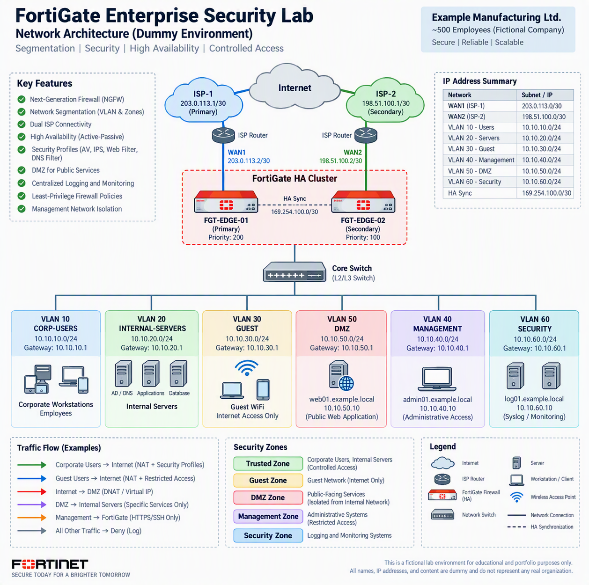

# FortiGate Enterprise Security Lab

A simulated enterprise network security implementation using FortiGate
Next-Generation Firewall.

This project demonstrates how a FortiGate firewall can be used to protect
an enterprise environment through network segmentation, application-aware
firewall policies, security profiles, secure internet access, DMZ isolation,
logging, and high availability.

> **Disclaimer**
>
> This repository is an independent lab project created for educational and
> portfolio purposes. All organization names, domain names, IP addresses,
> usernames, diagrams, and configurations are fictional or sanitized.
>
> This project is not affiliated with any current or previous employer.
> No production configuration, credential, confidential information, or
> customer data is included.

---

## Project Objectives

The objectives of this lab are:

- Design a segmented enterprise network
- Separate users, servers, guests, management, and DMZ systems
- Implement least-privilege firewall policies
- Control internet access using security profiles
- Publish a dummy web application securely
- Isolate public-facing systems from internal servers
- Simulate redundant internet connectivity
- Demonstrate FortiGate high availability
- Centralize security event and traffic logging
- Document firewall implementation and validation procedures

---

## Scope

This lab covers the following areas:

- FortiGate initial configuration
- Interface and VLAN configuration
- Security zones
- Static and default routing
- Firewall address objects
- Firewall service objects
- IPv4 firewall policies
- Source NAT
- Destination NAT using Virtual IP
- Web filtering
- Application control
- Intrusion Prevention System
- Antivirus scanning
- DNS filtering
- SSL inspection
- Administrative access hardening
- Logging and monitoring
- High availability design
- Configuration backup and validation

The following components are outside the current scope:

- Production deployment
- FortiManager implementation
- FortiAnalyzer implementation
- Full Active Directory integration
- Remote-access VPN
- Site-to-site IPsec VPN
- Zero Trust Network Access
- Secure SD-WAN performance testing

These components may be added in future lab versions.

---

## Fictional Company Scenario

`Example Manufacturing Ltd.` is a fictional company with approximately
500 employees.

The company operates:

- A primary office
- Internal business applications
- Microsoft Active Directory and DNS servers
- A public-facing customer portal
- Corporate wireless access
- Guest wireless access
- Network management systems
- Two internet service providers

The company requires network segmentation and controlled communication
between different security zones.

---

## Logical Architecture

The following diagram illustrates the enterprise network architecture used
in this fictional FortiGate security lab.

> Click the diagram to view the full-size architecture.

The architecture includes:

- Dual ISP connectivity with SD-WAN and failover
- FortiGate Active-Passive High Availability
- Dedicated HA synchronization links
- VLAN and security-zone segmentation
- Corporate user network
- Internal application, database, DNS, and NTP services
- Guest internet-only network
- DMZ for public-facing HTTPS services
- Restricted management network
- Centralized logging and monitoring network
- Least-privilege inter-zone communication

> **Disclaimer:** This diagram represents a fictional laboratory environment
> created for educational and portfolio purposes. All organizations, domain
> names, systems, IP addresses, and configurations shown are dummy data and
> do not represent any real organization.

## Skills Demonstrated

This lab demonstrates practical skills in enterprise firewall implementation,
network security architecture, security policy design, and technical
documentation.

### FortiGate Administration

- FortiGate Next-Generation Firewall administration
- FortiOS CLI configuration
- Interface and VLAN configuration
- Firewall address and service objects
- IPv4 firewall policy management
- Configuration backup and validation
- FortiGate troubleshooting commands

### Network Security Architecture

- Enterprise network security design
- VLAN-based network segmentation
- Security-zone architecture
- Corporate user network protection
- Internal server network isolation
- Guest-network isolation
- Dedicated management network
- DMZ architecture for public-facing services
- Security-monitoring network design

### Firewall Policy and Access Control

- Least-privilege firewall policy design
- Default-deny security model
- Inter-zone access control
- Policy ordering and rule optimization
- Source and destination restriction
- Service-based access control
- Administrative access restriction
- Denied-traffic logging

### NAT and Application Publishing

- Source Network Address Translation
- Destination Network Address Translation
- FortiGate Virtual IP configuration
- HTTPS application publishing
- Public-to-DMZ traffic control
- Secure inbound firewall policy design

### Threat Prevention

- Antivirus inspection
- Intrusion Prevention System
- Web filtering
- DNS filtering
- Application control
- SSL certificate inspection
- Malicious-traffic detection
- Security-profile implementation

### High Availability and Connectivity

- FortiGate Active-Passive High Availability
- HA heartbeat and synchronization
- Session synchronization
- Interface monitoring
- Dual ISP connectivity
- Internet-link failover planning
- Firewall failover validation

### Security Operations

- Centralized traffic logging
- Security-event monitoring
- Administrative-activity logging
- Configuration-change monitoring
- Incident troubleshooting
- Packet capture and debug flow
- Firewall-policy validation
- Security test-case development

### Security Engineering

- Defense-in-depth architecture
- Network attack-surface reduction
- Management-plane hardening
- Technical risk identification
- Configuration sanitization
- Security documentation
- Implementation planning
- Post-implementation validation

### Technologies and Concepts

`FortiGate` `FortiOS` `NGFW` `Firewall Policy` `VLAN` `Security Zones`
`Network Segmentation` `High Availability` `Dual WAN` `NAT` `DNAT`
`Virtual IP` `DMZ` `IPS` `Antivirus` `Web Filtering` `DNS Filtering`
`Application Control` `SSL Inspection` `Syslog` `Network Troubleshooting`
